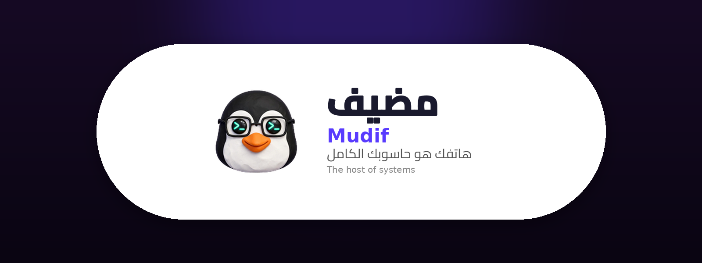

<div align="center">

 **العربية** | [English](README_en.md)

</div>

<p align="center">
  
</p>

<p align="center">
  
  
  
  
  
</p>

<p align="center"><em>«المستخدم لا يسمع كلمة لينكس أبدا.»</em></p>

<p align="center">
  <strong>مضيف يحوّل هاتفك إلى حاسوب كامل: نظام دبيان مع واجهة LXQt، بالعربية الفصحى، وتشغيل برامج ويندوز من المتجر.</strong>
</p>

<p align="center">
  <a href="https://github.com/taqniamostakbal/mudif/releases">الإصدارات</a> ·
  <a href="#features">الميزات</a> ·
  <a href="#screenshots">لقطات الشاشة</a> ·
  <a href="#install">التثبيت</a> ·
  <a href="#status">حالة المشروع</a> ·
  <a href="#contributing">المساهمة</a>
</p>

<a id="about"></a>
## ما هو مضيف

مضيف تطبيق أندرويد (`com.bolm.mudif`) يشغّل نظام دبيان (trixie) كاملا مع واجهة LXQt على الهاتف. واجهة المستخدم عربية فصحى بالكامل، والخطان Cairo وLifta، واللون البنفسجي `#593BFE` هو لون الهوية، والبطريق هو الشعار. يعمل على أندرويد 9 فما فوق.

> الرؤية: المستخدم لا يسمع كلمة لينكس أبدا. يضغط على ما يريد فعله، والنظام يتولى الباقي.

<a id="features"></a>
## الميزات

### المترجم: من x86-64 إلى ARM64

مترجم مبني من الصفر بلغة C (5,086 سطرا) يحوّل برامج x86-64 إلى ARM64. لا يستعمل Winlator ولا Box64 ولا FEX. الترجمة تتم مرة واحدة على جهاز البناء، والبرامج المترجمة تصل جاهزة داخل التطبيق، فيعمل الهاتف كودا أصليا بدون مترجم وقت التشغيل.

### طبقة ويندوز

طبقة ويندوز مبنية فوق المترجم تشغّل برامج ويندوز داخل سطح مكتب مضيف. البرنامج المثبت حاليا هو المفكرة (ReactOS Notepad، نسخة مفتوحة المصدر، وليست مفكرة مايكروسوفت)، وقد تحقق من 177 استيرادا، وتفتح نافذتها وتكتب النص وتفتح قائمة ملف (8 عناصر) وتخرج نظيفا.

### المتجر

كتالوج فيه 1,228 برنامج (إنترنت، مكتب، وسائط، تطوير، ذكاء اصطناعي، نظام، خطوط، ألعاب)، وكلها برامج مجانية ومفتوحة المصدر. بطاقة (الكل) في المتجر تعرض 1,139، لأن الخطوط (87) وبرامج ويندوز (2) لها بطاقاتها الخاصة. التثبيت بضغطة واحدة من داخل التطبيق، والبرامج المثبتة تظهر في قائمة التطبيقات.

### ميزات الإصدار p128 (ست ميزات جديدة)

**مؤشر الأداء (HUD):** شريحة صغيرة أعلى الشاشة تعرض FPS والذاكرة والبطارية والحرارة، وتتحدث كل ثانية. الذاكرة الحية مثبتة على جهاز الاختبار (3.2 غيغابايت، وارتفعت إلى 3.7 تحت حمل 500 ميغابايت ثم عادت). رقم FPS الحي وقيم البطارية والحرارة يحتاجان هاتفا حقيقيا.

**مكونات ويندوز لكل برنامج:** المتجر يعرض المكونات التي يحتاجها كل برنامج ويندوز، وبوابة التثبيت ترفض قبل أي تثبيت إن كان المكون غير متوفر. المتوفر في الإصدار الأول: `msvcrt` و`vcruntime140`. DirectX غير متوفر بالتصميم (لا خلفية D3D)، و`msvcp140` و`concrt140` غير متوفرين.

**تقرير الجهاز:** شاشة مخصصة تعرض 12 سطرا: الجهاز، المعالج، نظام أندرويد، الذاكرة، التخزين، الشاشة، كرت الرسوميات، Vulkan، البطارية، الصحة، الحرارة، الجهد. كل سطر طابق مصدره المستقل على جهاز الاختبار. القيم الحية للبطارية واسم كرت Adreno والمعالج الحقيقي تحتاج هاتفا حقيقيا.

**العرض الخارجي والتحكم عن بعد:** العرض الخارجي ينتقل بالعارض إلى الشاشة الخارجية، ويتبعه الإدخال، ويعود عند الفصل، والجلسة تبقى حية. التحكم عن بعد من المتصفح يعمل على الشبكة المحلية فقط: صفحة دخول، ورمز QR، وكلمة مرور من 8 أحرف تتغير مع كل إعادة تشغيل، وكتابة عربية متصلة من المتصفح. تلفاز حقيقي وشاشة DisplayPort حقيقية يحتاجان هاتفا حقيقيا.

**مشاركة الحافظة:** النسخ واللصق يتزامنان في الاتجاهين بين أندرويد والضيف، والعربية تصل متصلة. سطر في مركز التحكم يعرض الحالة (مفعّلة أو متوقفة). ملاحظة: نسخة وضعت قبل فتح العارض لا تصل حتى تنسخ من جديد.

**نقل الملفات:** إرسال ملف من الهاتف إلى الضيف باختيار الملف، مع شريط تقدم ورسالة نجاح تسمي المسار في الضيف. الملف المرسل يفتح في أندرويد بالتطبيق المناسب، وملف 50 ميغابايت أرسل بلا خطأ، وتعارض الأسماء يصير `(2)` بلا كتابة فوق الأصل، واختصار على سطح المكتب يفتح المجلد المشترك.

<a id="screenshots"></a>
## لقطات الشاشة

كل اللقطات من جهاز الاختبار (محاكي Redroid)، وليست صورا مصممة.

<p align="center">
  
</p>

<p align="center">تثبيت برنامج ويندوز من المتجر: بحث، ثم تأكيد المكونات، ثم تثبيت.</p>

<table>
  <tr>
    <td align="center"><br>سطح المكتب: نظام دبيان مع واجهة LXQt على الهاتف</td>
    <td align="center"><br>المتجر: برامج مجانية تثبت بضغطة واحدة</td>
  </tr>
  <tr>
    <td align="center"><br>مركز التحكم: المظهر والواي فاي والبلوتوث والحافظة</td>
    <td align="center"><br>تقرير الجهاز: 12 سطرا عن الجهاز والنظام</td>
  </tr>
  <tr>
    <td align="center"><br>التحكم عن بعد: رمز QR وكلمة مرور تتغير مع كل تشغيل</td>
    <td align="center"><br>مؤشر الأداء: FPS والذاكرة والبطارية والحرارة فوق سطح المكتب</td>
  </tr>
</table>

<a id="install"></a>
## التثبيت

### من الإصدارات

نشرات APK الجاهزة في صفحة [الإصدارات](https://github.com/taqniamostakbal/mudif/releases) في هذا المستودع. ثبّت فوق أي نسخة سابقة، ولا تلغ تثبيت التطبيق أبدا (إلغاء التثبيت يمسح نظام دبيان كاملا).

### من المصدر

المتطلبات: JDK 17، وAndroid SDK ‏(API 34)‏، وGradle 8.7.

```sh
git clone https://github.com/taqniamostakbal/mudif.git
cd mudif
gradle :app:assembleDebug
```

الملف الناتج: `app/build/outputs/apk/debug/app-debug.apk`

<a id="status"></a>
## حالة المشروع

الإصدار الحالي 0.2.2 (البناء p128). هذا ما ثبت فعلا، وما ما زال يحتاج هاتفا حقيقيا:

| الموضوع | الحالة |
|---|---|
| الميزات الست في p128 | مثبتة على جهاز الاختبار (محاكي Redroid ‏x86_64‏) |
| المترجم v0 وv1 | مثبت، والمخرجات مطابقة بايت بايت |
| طبقة ويندوز والمفكرة | مثبتة على جهاز الاختبار (النافذة، الكتابة، القائمة، الخروج) |
| التشغيل على هاتف حقيقي (ARM64) | لم يختبر بعد |
| FPS الحي والبطارية والحرارة وكرت Adreno | تحتاج هاتفا حقيقيا |
| تلفاز حقيقي وعرض DisplayPort | يحتاجان هاتفا حقيقيا |
| البناءات الآلية (CI) | متوقفة حاليا، والإصدارات تبنى وتتحقق محليا |

حدود معروفة:

- تنسيق `printf` بالنمط `%08x` يسقط صفرا بادئا (عيب في المترجم، والسبب الجذري لم يوجد بعد).
- الحفظ من داخل المفكرة نفسها ما زال محدودا (نافذة الحفظ تعيد الإلغاء).
- شارة `!` حمراء تظهر على أيقونات سطح المكتب (موجودة من قبل، وسببها لم يثبت بعد).

<a id="layout"></a>
## بنية المشروع

```
mudif/
├── app/                  # Android app (Kotlin, com.bolm.mudif)
├── tv/                   # Android TV receiver: shows the phone desktop on a TV
├── brand/                # BRAND.md + icon master
├── doc/                  # ARCHITECTURE.md and design docs
├── gradle/               # version catalog
├── build.gradle.kts
├── settings.gradle.kts
└── README.md
```

<a id="contributing"></a>
## المساهمة

مضيف مشروع شخصي من تقنية المستقبل | Exploring Tech. إن وجدت خطأ، افتح Issue مع لقطة شاشة وخطوات الإعادة، أو أرسل Pull Request صغيرا في نطاق ضيق. لا ترسل تغييرات خارج نطاق المشكلة.

---

تقنية المستقبل | Exploring Tech

© 2026 تقنية المستقبل | Exploring Tech: جميع الحقوق محفوظة
