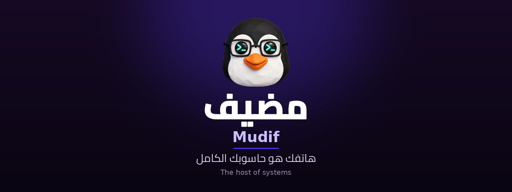
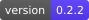
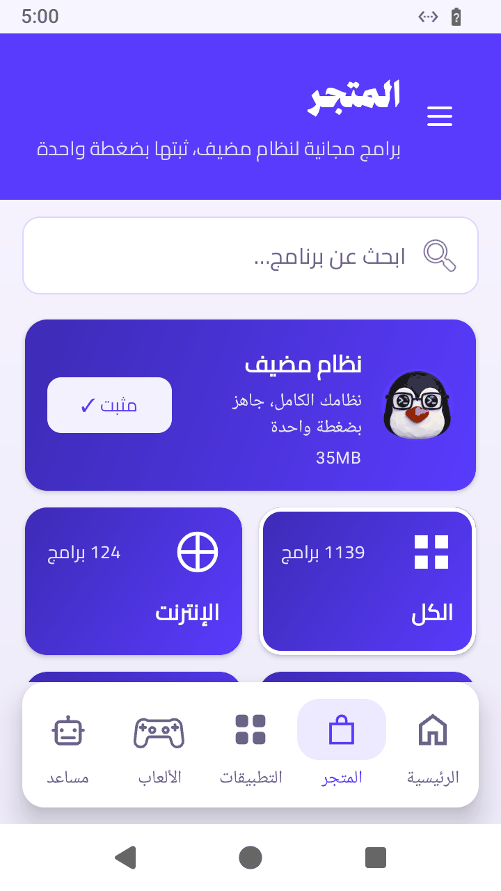
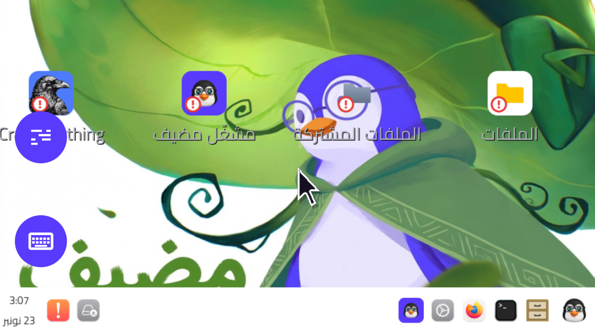
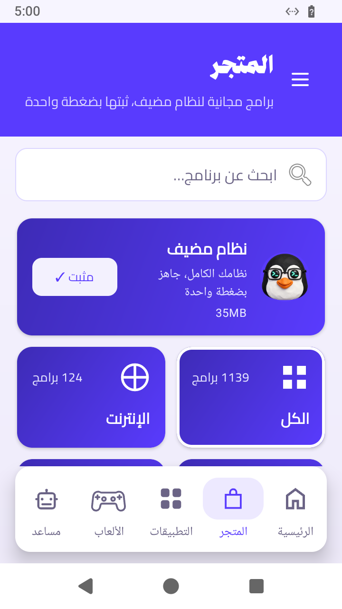
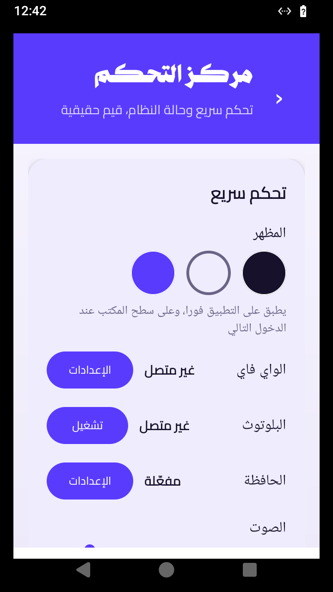
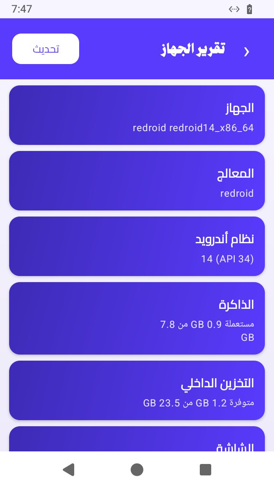
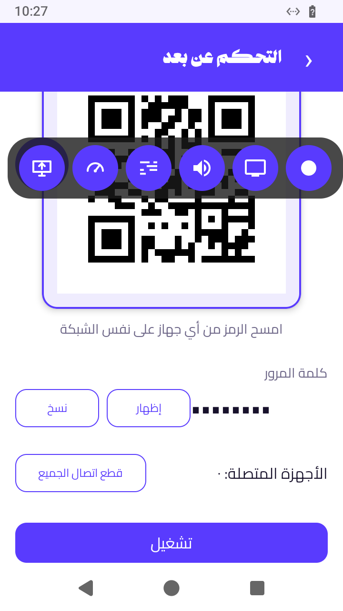
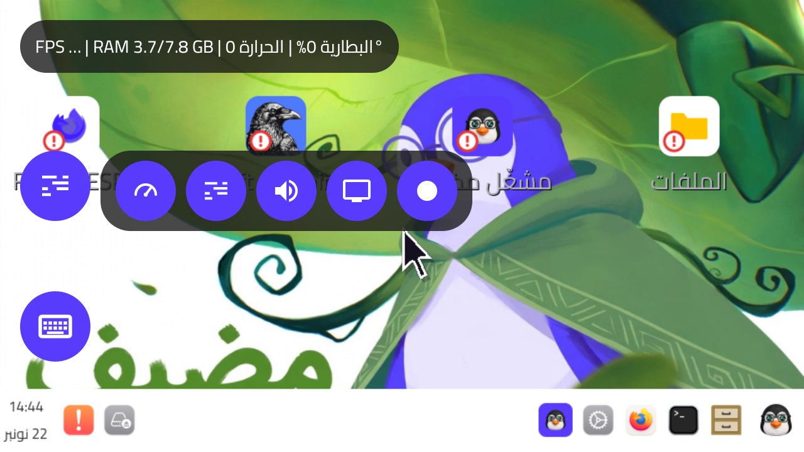

<div align="center">

[العربية](README.md) | [English](README_en.md) | **الدارجة**

</div>

<p align="center">
  
</p>

<p align="center">
  
  
  
  
  
</p>

<p align="center">
  <strong>مضيف كيحوّل التيليفون ديالك لحاسوب كامل: نظام دبيان بواجهة LXQt، بالعربية الفصحى، وكيشغّل برامج ويندوز من المتجر.</strong>
</p>

<p align="center">
  <a href="https://github.com/taqniamostakbal/mudif/releases">الإصدارات</a> ·
  <a href="#features">المزايا</a> ·
  <a href="#screenshots">لقطات الشاشة</a> ·
  <a href="#install">التثبيت</a> ·
  <a href="#status">حالة المشروع</a> ·
  <a href="#contributing">المساهمة</a>
</p>

<a id="about"></a>
## شنو هو مضيف

مضيف تطبيق أندرويد (`com.bolm.mudif`) كيشغّل نظام دبيان (trixie) كامل بواجهة LXQt فالتيليفون. الواجهة كاملة بالعربية الفصحى، والخطوط هوما Cairo وLifta، واللون البنفسجي `#593BFE` هو لون الهوية، والبطريق هو الشعار. كيخدم فأندرويد 9 ولفوق.

> الرؤية: المستخدم ما يسمع كلمة لينكس أبدا. كيضغط على اللي بغا يدير، والنظام كيتكلف بالباقي.

<a id="features"></a>
## المزايا

### المترجم: من x86-64 لـ ARM64

مترجم مبني من الصفر بلغة C (5,086 سطر) كيحوّل برامج x86-64 لـ ARM64. ما كيستعمل لا Winlator ولا Box64 ولا FEX. الترجمة كتدار مرة وحدة فجهاز البناء، والبرامج المترجمة كتوصلك واجدة داخل التطبيق، والتيليفون كيشغّل كود أصلي بلا مترجم وقت التشغيل.

### طبقة ويندوز

طبقة ويندوز مبنية فوق المترجم كتشغّل برامج ويندوز داخل سطح مكتب مضيف. البرنامج المثبت دابا هو المفكرة (ReactOS Notepad، النسخة مفتوحة المصدر، ماشي مفكرة مايكروسوفت)، وتأكدنا من 177 استيراد، والنافذة ديالها كتحل، وكتكتب النص، وكتحل قائمة ملف (8 عناصر)، وكتخرج نظيفة.

### المتجر

كتالوج فيه 1,228 برنامج (إنترنت، مكتب، وسائط، تطوير، ذكاء اصطناعي، نظام، خطوط، ألعاب)، وكاملين برامج مجانية ومفتوحة المصدر. بطاقة (الكل) فالمتجر كتعرض 1,139، حيت الخطوط (87) وبرامج ويندوز (2) عندهم البطاقات ديالهم. التثبيت بضغطة وحدة من داخل التطبيق، والبرامج المثبتة كتبان فقائمة التطبيقات.

### مزايا الإصدار p128 (ست مزايا جداد)

**مؤشر الأداء (HUD):** شريحة صغيرة فوق الشاشة كتعرض FPS والذاكرة والبطارية والحرارة، وكتحدث كل ثانية. الذاكرة الحية تأكدنا منها فجهاز الاختبار (3.2 غيغابايت، وطلعات لـ 3.7 تحت حمل 500 ميغابايت ورجعات). رقم FPS الحي وقيم البطارية والحرارة خاصهم تيليفون حقيقي.

**مكونات ويندوز لكل برنامج:** المتجر كيعرض المكونات اللي كيحتاجها كل برنامج ويندوز، وبوابة التثبيت كترفض قبل أي تثبيت إلا كان المكون ما كاينش. اللي متوفر فالإصدار الأول: `msvcrt` و`vcruntime140`. DirectX ما متوفرش بالتصميم (ما كايناش خلفية D3D)، و`msvcp140` و`concrt140` ما متوفرينش.

**تقرير الجهاز:** شاشة خاصة كتعرض 12 سطر: الجهاز، المعالج، نظام أندرويد، الذاكرة، التخزين، الشاشة، كرت الرسوميات، Vulkan، البطارية، الصحة، الحرارة، الجهد. كل سطر طابق المصدر المستقل ديالو فجهاز الاختبار. القيم الحية ديال البطارية وسمية كرت Adreno والمعالج الحقيقي خاصهم تيليفون حقيقي.

**العرض الخارجي والتحكم عن بعد:** العرض الخارجي كينقل العارض للشاشة الخارجية، والإدخال كيتبعو، وكيرجع ملي كتفصل، والجلسة كتبقى حية. التحكم عن بعد من المتصفح كيخدم غير فالشبكة المحلية: صفحة دخول، ورمز QR، وكلمة مرور من 8 حروف كتبدل مع كل إعادة تشغيل، وكتابة عربية متصلة من المتصفح. تلفاز حقيقي وشاشة DisplayPort حقيقية خاصهم تيليفون حقيقي.

**مشاركة الحافظة:** النسخ واللصق كيتزامنو فالاتجاهين بين أندرويد والضيف، والعربية كتوصل متصلة. سطر فمركز التحكم كيعرض الحالة (مفعّلة ولا متوقفة). ملاحظة: نسخة تحطات قبل ما تحل العارض ما كتوصلش حتى تنسخها من جديد.

**نقل الملفات:** صيفط ملف من التيليفون للضيف باختيار الملف، مع شريط تقدم ورسالة نجاح كتسمي المسار فالضيف. الملف المصيفط كيتحل فأندرويد بالتطبيق المناسب، وملف 50 ميغابايت تصيفط بلا خطأ، وتعارض الأسماء كيولي `(2)` بلا ما يكتب فوق الأصل، واختصار فسطح المكتب كيحل المجلد المشترك.

<a id="screenshots"></a>
## لقطات الشاشة

كامل اللقطات من جهاز الاختبار (محاكي Redroid)، ماشي صور مصممة.

<p align="center">
  
</p>

<p align="center">تثبيت برنامج ويندوز من المتجر: بحث، ثم تأكيد المكونات، ثم تثبيت.</p>

<table>
  <tr>
    <td align="center"><br>سطح المكتب: نظام دبيان بواجهة LXQt فالتيليفون</td>
    <td align="center"><br>المتجر: برامج مجانية كتثبت بضغطة وحدة</td>
  </tr>
  <tr>
    <td align="center"><br>مركز التحكم: المظهر والواي فاي والبلوتوث والحافظة</td>
    <td align="center"><br>تقرير الجهاز: 12 سطر على الجهاز والنظام</td>
  </tr>
  <tr>
    <td align="center"><br>التحكم عن بعد: رمز QR وكلمة مرور كتبدل مع كل تشغيل</td>
    <td align="center"><br>مؤشر الأداء: FPS والذاكرة والبطارية والحرارة فوق سطح المكتب</td>
  </tr>
</table>

<a id="install"></a>
## التثبيت

### من الإصدارات

نشرات APK الواجدة كاينين فصفحة [الإصدارات](https://github.com/taqniamostakbal/mudif/releases) فهاد المستودع. ثبّت فوق أي نسخة قديمة، وما تلغيش تثبيت التطبيق أبدا (إلغاء التثبيت كيمسح نظام دبيان كامل).

### من المصدر

المتطلبات: JDK 17، وAndroid SDK ‏(API 34)‏، وGradle 8.7.

```sh
git clone https://github.com/taqniamostakbal/mudif.git
cd mudif
gradle :app:assembleDebug
```

الملف الناتج: `app/build/outputs/apk/debug/app-debug.apk`

<a id="status"></a>
## حالة المشروع

الإصدار الحالي 0.2.2 (البناء p128). هادشي اللي تأكد فعلا، وهادشي اللي ما زال خاصو تيليفون حقيقي:

| الموضوع | الحالة |
|---|---|
| المزايا الست فـ p128 | تأكدنا منها فجهاز الاختبار (محاكي Redroid ‏x86_64‏) |
| المترجم v0 وv1 | تأكدنا منو، والمخرجات مطابقة بايت بايت |
| طبقة ويندوز والمفكرة | تأكدنا منها فجهاز الاختبار (النافذة، الكتابة، القائمة، الخروج) |
| التشغيل فتيليفون حقيقي (ARM64) | ما تختبرش بعد |
| FPS الحي والبطارية والحرارة وكرت Adreno | خاصهم تيليفون حقيقي |
| تلفاز حقيقي وعرض DisplayPort | خاصهم تيليفون حقيقي |
| البناءات الآلية (CI) | واقفة دابا، والإصدارات كتبنى وكتأكد محليا |

حدود معروفة:

- تنسيق `printf` بالنمط `%08x` كيسقط صفر بادئ (عيب فالمترجم، والسبب الجذري ما لقيناهش بعد).
- الحفظ من داخل المفكرة نفسها ما زال محدود (نافذة الحفظ كترجع الإلغاء).
- شارة `!` حمرا كتبان على أيقونات سطح المكتب (موجودة من قبل، وسببها ما تأكدش بعد).

<a id="layout"></a>
## بنية المشروع

```
mudif/
├── app/                  # Android app (Kotlin, com.bolm.mudif)
├── tv/                   # Android TV receiver: shows the phone desktop on a TV
├── brand/                # BRAND.md + icon master
├── doc/                  # ARCHITECTURE.md and design docs
├── gradle/               # version catalog
├── build.gradle.kts
├── settings.gradle.kts
└── README.md
```

<a id="contributing"></a>
## المساهمة

مضيف مشروع شخصي ديال صاحبو أنس بوعلام. إلا لقيتي خطأ، حل Issue مع لقطة شاشة وخطوات الإعادة، ولا صيفط Pull Request صغير فنطاق ضيق. ما تصيفطش تغييرات خارج نطاق المشكلة.

---

تقنية المستقبل | Exploring Tech

© 2026 Anas boualam، الحقوق كاملين محفوظين.
