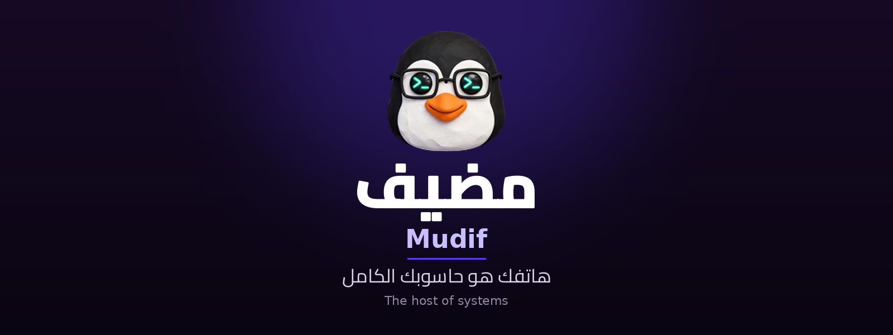
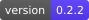
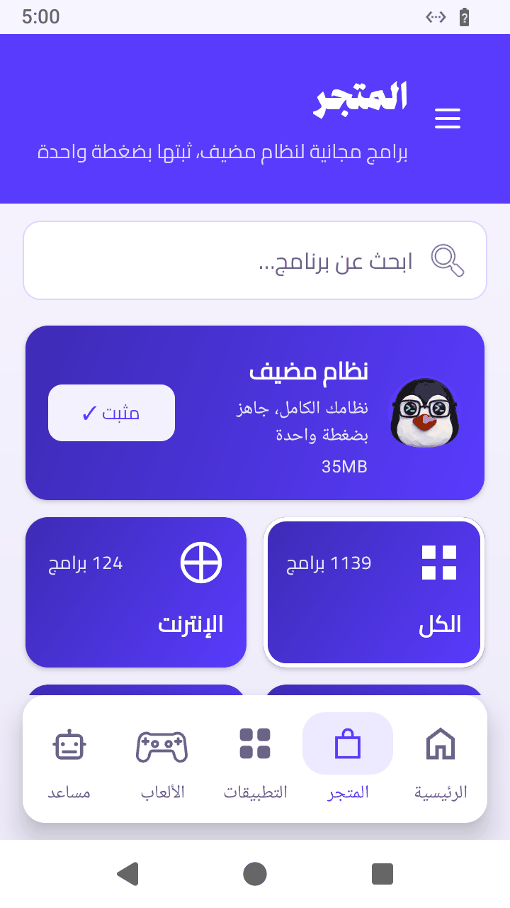
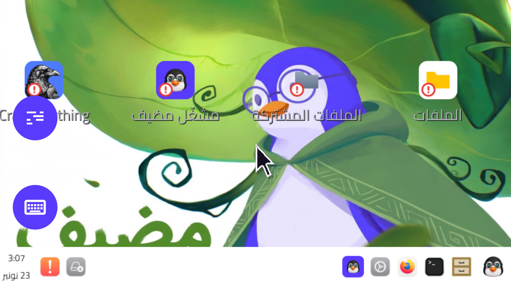
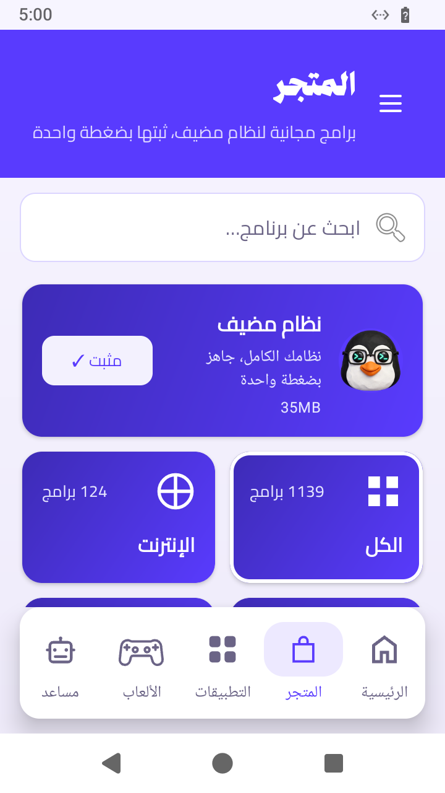
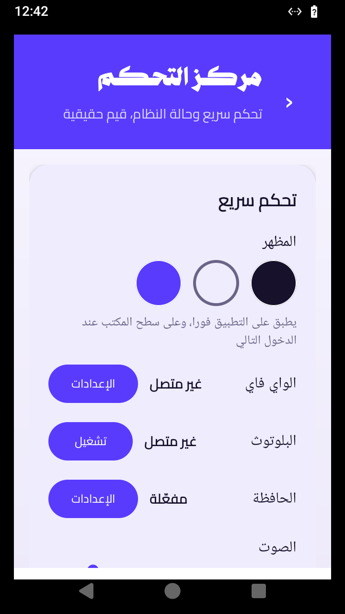
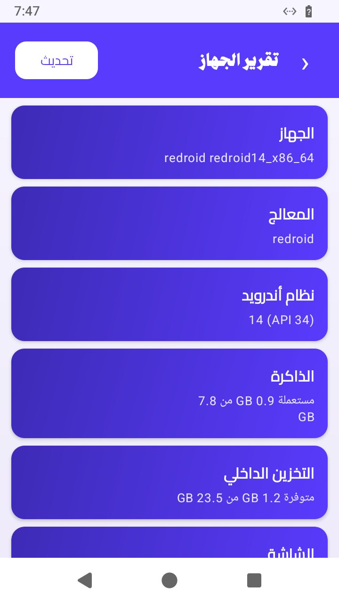
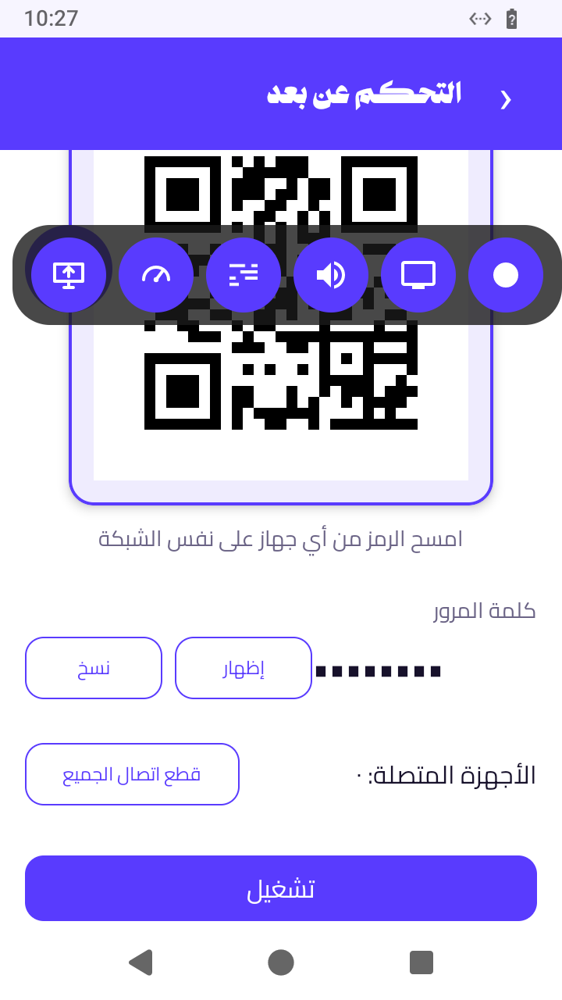
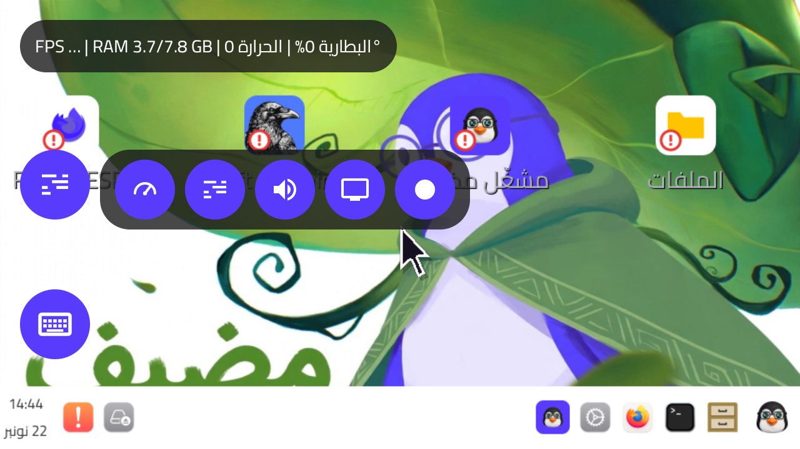

<div align="center">

[العربية](README.md) | **English** | [الدارجة](README_darija.md)

</div>

<p align="center">
  
</p>

<p align="center">
  
  
  
  
  
</p>

<p align="center">
  <strong>Mudif turns your phone into a full computer: a Debian system with the LXQt desktop, in Fusha Arabic, running Windows programs from the store.</strong>
</p>

<p align="center">
  <a href="https://github.com/taqniamostakbal/mudif/releases">Releases</a> ·
  <a href="#features">Features</a> ·
  <a href="#screenshots">Screenshots</a> ·
  <a href="#install">Install</a> ·
  <a href="#status">Project status</a> ·
  <a href="#contributing">Contributing</a>
</p>

<a id="about"></a>
## What is Mudif

Mudif is an Android app (`com.bolm.mudif`) that runs a full Debian (trixie) system with the LXQt desktop on the phone. The interface is entirely in Fusha Arabic, the fonts are Cairo and Lifta, the brand color is purple `#593BFE`, and the logo is a penguin. It runs on Android 9 and above.

> Vision: the user never hears the word Linux. They tap what they want to do, and the system handles the rest.

<a id="features"></a>
## Features

### The translator: x86-64 to ARM64

A translator built from scratch in C (5,086 lines) that converts x86-64 programs to ARM64. It uses no Winlator, no Box64, and no FEX. Translation happens once, on the build machine, and the translated programs ship ready inside the app, so the phone runs native code with no translator at runtime.

### The Windows layer

A Windows layer built on the translator runs Windows programs inside the Mudif desktop. The program installed today is Notepad (ReactOS Notepad, the open-source version, not Microsoft Notepad): 177 imports resolved, its window opens, it types text, it opens the File menu (8 items), and it exits cleanly.

### The store

A catalog of 1,228 programs (internet, office, media, development, AI, system, fonts, games), all free and open source. The store's All tile shows 1,139, because fonts (87) and Windows programs (2) have their own tiles. Install with one tap from inside the app, and installed programs appear in the app list.

### The p128 release (six new features)

**Performance HUD:** a small chip at the top of the screen shows FPS, RAM, battery, and temperature, updating every second. Live RAM is verified on the test device (3.2 GB, rising to 3.7 under a 500 MB load, then back). The live FPS number and the live battery and temperature values need a real phone.

**Per-program Windows components:** the store shows the components each Windows program needs, and the install gate refuses before anything is installed when a component is missing. Available in the first version: `msvcrt` and `vcruntime140`. DirectX is not available, by design (no D3D backend), and `msvcp140` and `concrt140` are not available.

**Device report:** a dedicated screen shows 12 rows: device, processor, Android system, RAM, storage, display, graphics card, Vulkan, battery, health, temperature, voltage. Every row matched its independent source on the test device. Live battery values, the real Adreno card name, and the real processor name need a real phone.

**External display and remote control:** the external display moves the viewer to the external screen, input follows it, and it returns on unplug, with the session staying alive. Browser remote control works on the local network only: a login page, a QR code, and an 8-character password that changes on every restart, with joined Arabic typing from the browser. A real TV and a real DisplayPort screen need a real phone.

**Clipboard sharing:** copy and paste sync both ways between Android and the guest, and Arabic arrives joined. A row in the Control Center shows the state (enabled or stopped). Note: a clip set before the viewer opens does not arrive until it is copied again.

**File transfer:** send a file from the phone to the guest by picking the file, with a progress bar and a success message naming the guest path. The sent file opens on Android in the right app, a 50 MB file was sent with no error, a name clash becomes `(2)` without overwriting the original, and a desktop shortcut opens the shared folder.

<a id="screenshots"></a>
## Screenshots

All screenshots are from the test device (Redroid emulator), not designed images.

<p align="center">
  
</p>

<p align="center">Installing a Windows program from the store: search, confirm the components, then install.</p>

<table>
  <tr>
    <td align="center"><br>The desktop: Debian with LXQt on the phone</td>
    <td align="center"><br>The store: free programs, one-tap install</td>
  </tr>
  <tr>
    <td align="center"><br>Control Center: appearance, Wi-Fi, Bluetooth, clipboard</td>
    <td align="center"><br>Device report: 12 rows about the device and the system</td>
  </tr>
  <tr>
    <td align="center"><br>Remote control: QR code and a password that changes on every start</td>
    <td align="center"><br>Performance HUD: FPS, RAM, battery, and temperature over the desktop</td>
  </tr>
</table>

<a id="install"></a>
## Install

### From the releases

Ready APK builds are on the [Releases](https://github.com/taqniamostakbal/mudif/releases) page in this repository. Install over any previous version, and never uninstall the app (uninstalling wipes the whole Debian system).

### From source

Requirements: JDK 17, Android SDK (API 34), Gradle 8.7.

```sh
git clone https://github.com/taqniamostakbal/mudif.git
cd mudif
gradle :app:assembleDebug
```

Output file: `app/build/outputs/apk/debug/app-debug.apk`

<a id="status"></a>
## Project status

The current version is 0.2.2 (build p128). What is actually verified, and what still needs a real phone:

| Subject | Status |
|---|---|
| The six features in p128 | Verified on the test device (Redroid x86_64 emulator) |
| Translator v0 and v1 | Verified, output byte-identical |
| Windows layer and Notepad | Verified on the test device (window, typing, menu, clean exit) |
| Running on a real phone (ARM64) | Not tested yet |
| Live FPS, battery, temperature, Adreno card | Need a real phone |
| Real TV and DisplayPort display | Need a real phone |
| Automated builds (CI) | Paused at the moment, releases are built and verified locally |

Known limits:

- `printf` with the `%08x` format drops a leading zero (a translator defect, root cause not found yet).
- Saving from inside Notepad itself is still limited (the save dialog returns cancelled).
- A red `!` badge appears on desktop icons (pre-existing, cause not established yet).

<a id="layout"></a>
## Project layout

```
mudif/
├── app/                  # Android app (Kotlin, com.bolm.mudif)
├── tv/                   # Android TV receiver: shows the phone desktop on a TV
├── brand/                # BRAND.md + icon master
├── doc/                  # ARCHITECTURE.md and design docs
├── gradle/               # version catalog
├── build.gradle.kts
├── settings.gradle.kts
└── README.md
```

<a id="contributing"></a>
## Contributing

Mudif is a personal project by its owner, Anas boualam. If you find a bug, open an Issue with a screenshot and steps to reproduce, or send a small Pull Request in a narrow scope. Do not send changes outside the scope of the problem.

---

تقنية المستقبل | Exploring Tech

Copyright © 2026 Anas boualam. All rights reserved.
